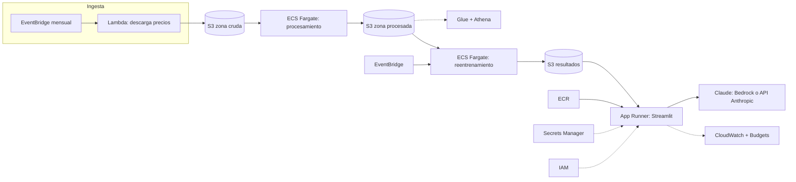

# Arquitectura en AWS (diseño propuesto, no desplegado)

Infografía: [`arquitectura/infografia_aws.svg`](arquitectura/infografia_aws.svg) (también
[`infografia_canva.png`](arquitectura/infografia_canva.png) y [`infografia_aws.html`](arquitectura/infografia_aws.html)).
Es documentación de diseño; la app no incluye esta arquitectura.

| Componente | Servicio AWS | Qué hace | Por qué |
|---|---|---|---|
| Ingesta programada | EventBridge + Lambda | Dispara cada mes una función que descarga precios y compras. | Sin servidores que mantener; se paga solo por ejecución. |
| Zona cruda | S3 (versionado) | Guarda los CSV originales sin tocar. | Los datos originales nunca se editan; el versionado permite auditar. |
| Procesamiento | ECS Fargate (job) | Unifica formatos, audita y corrige atípicos (utils.py, auditoria.py). | El trabajo dura minutos y necesita librerías científicas: un contenedor es más simple que Lambda. |
| Consulta ad hoc | Glue Data Catalog + Athena | Permite consultar con SQL las series limpias y el log de correcciones. | Análisis exploratorio sin montar una base de datos. |
| Zona procesada | S3 | Series mensuales limpias y registro de cada corrección. | Separa dato crudo de dato curado. |
| Reentrenamiento | EventBridge + ECS Fargate | Corre el pipeline completo tras cada ingesta: fórmula, backtesting y Monte Carlo. | Mantiene la fórmula y el pronóstico al día sin intervención. |
| Zona de resultados | S3 | Fórmulas, pronósticos, abanicos y métricas (JSON/Parquet). | La app y el agente leen resultados ya calculados: respuesta inmediata. |
| Aplicación web | App Runner + ECR | Sirve la app Streamlit desde un contenedor con HTTPS y escalado automático. | Despliegue más simple que ECS + balanceador para una app interna. |
| Agente de IA | Claude vía Bedrock o API de Anthropic | Responde sobre los resultados usando herramientas. | Bedrock mantiene el tráfico dentro de AWS; la API directa es más simple de arrancar. |
| Secretos | Secrets Manager | Guarda la API key y credenciales. | Nunca van en el código ni en la imagen. |
| Permisos | IAM | Roles de mínimo privilegio por componente. | Cada pieza accede solo a lo que necesita. |
| Observabilidad y costo | CloudWatch + Budgets | Logs, alarmas de fallos y alertas de gasto. | Detecta un reentrenamiento fallido y evita sorpresas en la factura. |
